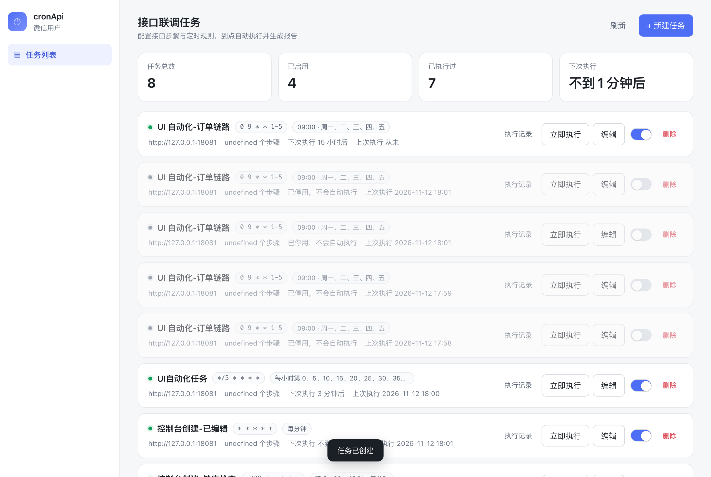

# cronApi — 自动联调服务

> 基于 **Go 1.22 + Gin** 的接口自动联调平台：按 cron 定时（或手动）执行「多步骤接口用例」，
> 自动完成小程序登录态获取、上游结果提取透传下游、断言校验、失败重试与执行报告落库。

---

## 一、为什么选 Go / Gin

| 维度 | 说明 |
| --- | --- |
| 场景匹配 | 本项目本质是「常驻 + 高并发出站 HTTP + 定时调度」，Go 的 goroutine 与标准库 net/http 天然适合 |
| 定时任务 | Go 生态 `robfig/cron` 成熟稳定，支持秒级 cron；对比 Node 的 setInterval 无内置 cron 语义 |
| 部署 | 单二进制、无运行时依赖，容器镜像 ~20MB，比 Node/Python 交付更简单 |
| 稳定性 | 静态编译 + 强类型，长时间运行不易内存泄漏；协程栈按需增长，常驻内存低 |
| 小程序登录态 | code2session、JWT 签发校验、Redis 会话都能用标准库 + 少量成熟库直接实现，没有语言层面的坑 |

**结论：完全可以用 Go，且 Gin 是非常合适的选择。**

### 依赖选型

| 能力 | 选择 | 理由 |
| --- | --- | --- |
| Web 框架 | `gin-gonic/gin v1.10` | 路由分组、中间件链、参数绑定/校验齐全，生态最大 |
| 配置 | `spf13/viper` | YAML + 环境变量覆盖，容器化友好 |
| 日志 | `go.uber.org/zap` | 结构化日志，自动带 trace_id |
| 定时调度 | `robfig/cron/v3` | 5/6 段表达式 + @every，优雅 |
| 存储 | `gorm` + MySQL | 任务与执行报告；也可换 Postgres/SQLite |
| 会话/缓存 | `go-redis/v9` | 登录态会话、限流计数、分布式锁 |
| JWT | **标准库自实现** `pkg/jwtutil` | 只需 HS256，省一个依赖，且便于控制 typ 防混用 |
| HTTP 出站 | 标准库 + `pkg/httpx` | 连接池复用、超时、限制响应体大小 |

> 若团队已经在用 Spring/Django，也可以用，但联调平台属于「轻业务、重调度与 IO」，Go 的部署与运维成本最低。

---

## 二、目录结构（中等项目分层）

```
cronApi/
├── cmd/server/               # 入口：装配依赖、启动调度器与 HTTP、优雅退出
├── configs/                  # config.yaml / config.local.yaml
├── deploy/                   # Dockerfile、docker-compose(MySQL+Redis)
├── examples/                 # smoke.http 冒烟脚本、示例任务 JSON
├── internal/
│   ├── auth/                 # 登录身份 Context + 鉴权中间件(Require/Optional)
│   ├── config/               # 配置加载与强校验
│   ├── errcode/              # 业务错误码 + BizError(可 Unwrap)
│   ├── handler/              # 接入层：绑定参数、调 service、统一响应
│   ├── logger/               # zap 封装 + trace 透传
│   ├── middleware/           # Trace / AccessLog / Recovery / RateLimit
│   ├── model/                # GORM 模型（User / Task / Run）+ JSON 列类型
│   ├── repository/           # 数据访问层（接口 + GORM 实现）
│   ├── response/             # 统一响应体 {code,msg,data,trace_id}
│   ├── router/               # 路由注册
│   ├── server/               # HTTP Server 生命周期
│   ├── service/
│   │   ├── auth/             # 小程序登录态：code2session + 会话 + JWT
│   │   ├── wechat/           # 微信客户端（真实 / Mock 两种实现）
│   │   ├── runner/           # 联调执行引擎：模板、提取、断言、重试
│   │   ├── scheduler/        # cron 调度（热加载、防重入、并发上限）
│   │   └── task/             # 任务 CRUD 与执行编排
│   └── store/                # MySQL / Redis 连接、迁移
└── pkg/                      # 可复用基础设施
    ├── cache/                # KV 抽象（Redis / 内存）
    ├── httpx/                # 出站 HTTP 客户端
    └── jwtutil/              # HS256 JWT 签发与校验
```

**依赖方向严格单向**：`handler → service → repository → model`；
`pkg` 与 `internal/middleware` 不反向依赖业务。

---

## 三、本地跑起来（3 步）

### 前置条件

| 依赖 | 要求 | 检查命令 |
| --- | --- | --- |
| Go | 1.22+ | `go version` |
| MySQL | 8.0，root / 3306 | `nc -z 127.0.0.1 3306` |
| Redis | 可选 | `nc -z 127.0.0.1 6379` |

一条命令自检：`make deps`

### 第 1 步：启动 MySQL 与 Redis

```bash
# MySQL：macOS 用系统服务启动（已装官方版时）
sudo launchctl load -w /Library/LaunchDaemons/com.oracle.oss.mysql.mysqld.plist
# 或 brew: brew services start mysql

# Redis：项目自带命令（后台运行、不落盘，仅开发用）
make redis-start
```

> **没有 Redis 也能跑**：把 `configs/config.local.yaml` 里的 `redis.enabled` 改成 `false`，
> 会话会退化为进程内存储（单实例调试够用，重启后需重新登录）。

### 第 2 步：建库建表（执行一次即可）

```bash
make db-init
# 等价于：mysql -h127.0.0.1 -P3306 -uroot -p < deploy/mysql/schema.sql
```

建出 3 张表：`sys_user`（用户）、`cron_task`（任务）、`cron_run`（执行记录），
完整语句见 [deploy/mysql/schema.sql](deploy/mysql/schema.sql)。

> 也可以**只建库不建表**：`CREATE DATABASE cron_api DEFAULT CHARACTER SET utf8mb4;`
> 服务启动时会自动建表（已实测）。

### 第 3 步：启动

```bash
# root 有密码时用环境变量传入，不要写进配置文件
export CRONAPI_MYSQL_PASSWORD='你的root密码'

go run ./cmd/server -c configs/config.local.yaml
# 或：make run
```

启动日志出现下面几行即成功：

```text
INFO  redis connected        {"addr": "127.0.0.1:6379"}
INFO  mysql connected        {"database": "cron_api"}
INFO  http server listening  {"addr": ":8080"}
```

然后浏览器打开 **http://127.0.0.1:8080/**，登录码填 `openid:dev` 即可进入控制台。

### 冒烟验证

```bash
curl -X POST localhost:8080/api/v1/auth/wechat/login \
  -H 'Content-Type: application/json' -d '{"code":"openid:u1001"}'
```

或直接用 [examples/smoke.http](examples/smoke.http) 在 IDE 里逐个执行。

> **关于 `make up`**：它调用的是 `docker compose` 拉取 MySQL + Redis 容器，
> 本机没装 Docker 时无法使用；上表第 1 步用的是本机已装的 MySQL/Redis，效果相同。

### 常见问题

| 现象 | 原因 / 处理 |
| --- | --- |
| `Access denied for user 'root'@'localhost'` | root 有密码，用 `CRONAPI_MYSQL_PASSWORD` 传入 |
| `Unknown database 'cron_api'` | 没建库，执行 `make db-init` |
| `连接 Redis 失败` | Redis 没启动；执行 `make redis-start` 或设 `redis.enabled=false` |
| 时间差 8 小时 | 本机 MySQL 的 `time_zone` 与配置里 `mysql.timezone` 不一致 |
| `GOMODCACHE NOT writable` | `~/go/pkg/mod` 无写权限，执行 `sudo chown -R $(whoami) ~/go/pkg` |

---

## 四、连接公网 MySQL 的配置清单

数据库在公网服务器上时，按下面 5 个环节依次检查。**任何一步不通，现象都是「启动时 ping 失败」**，排查时逐层排除。

### 1. 服务器侧：MySQL 监听公网地址

`deploy/mysql/prod.cnf` 里已写好，关键是三行：

```ini
bind-address      = 0.0.0.0   # 默认 127.0.0.1 时公网连不上
skip-name-resolve             # 公网反解 DNS 很慢，会拖慢每次建连
default-time-zone = '+08:00'  # 必须与 config 的 mysql.timezone 一致
```

修改后 `systemctl restart mysql`，用 `ss -lntp | grep 3306` 确认监听在 `0.0.0.0`。

### 2. 网络侧：安全组 / 防火墙放行

```bash
# 云服务器：安全组入方向添加规则 TCP 3306，来源填 cronApi 服务器的出口 IP（不要 0.0.0.0/0）
# 本机防火墙示例：
sudo ufw allow from 8.8.4.4 to any port 3306 proto tcp   # Ubuntu
sudo firewall-cmd --permanent --add-rich-rule='rule family="ipv4" source address="8.8.4.4" port port="3306" protocol="tcp" accept'
```

### 3. 账号侧：建库 + 最小权限账号

执行 `deploy/mysql/init.sql`（记得把 `'cronapi'@'8.8.4.4'` 换成 cronApi 服务器的出口 IP）：

```sql
CREATE USER 'cronapi'@'8.8.4.4' IDENTIFIED BY '强密码';
GRANT SELECT, INSERT, UPDATE, DELETE, CREATE, ALTER, INDEX, REFERENCES ON cron_api.* TO 'cronapi'@'8.8.4.4';
```

> 需要 `CREATE/ALTER/INDEX` 是因为服务启动时会 AutoMigrate 建表。表结构稳定后可去掉这三项，并把 AutoMigrate 关掉。
> `MAX_USER_CONNECTIONS` 建议 ≥ `max_open_conns × 实例数`。

### 4. 应用侧：cronApi 配置

复制 `configs/config.prod.yaml`，或直接用环境变量注入（推荐，密码不进代码库）：

```bash
export CRONAPI_APP_ENV=prod
export CRONAPI_MYSQL_ENABLED=true
export CRONAPI_MYSQL_HOST=8.8.8.8
export CRONAPI_MYSQL_PORT=3306
export CRONAPI_MYSQL_USER=cronapi
export CRONAPI_MYSQL_PASSWORD='强密码'
export CRONAPI_MYSQL_DATABASE=cron_api
export CRONAPI_MYSQL_TIMEZONE=Asia/Shanghai
export CRONAPI_MYSQL_MAX_OPEN_CONNS=50
export CRONAPI_MYSQL_CONN_MAX_LIFETIME=30m
export CRONAPI_JWT_SECRET="$(openssl rand -base64 32)"
```

| 参数 | 公网场景建议 | 为什么 |
| --- | --- | --- |
| `mysql.timezone` | `Asia/Shanghai` | **必填**。不填时用进程时区，容器默认 UTC 会让时间差 8 小时 |
| `mysql.conn_max_lifetime` | `30m` | 公网/云网关常在 30~60 分钟掐断空闲连接；短于该值可避免 `invalid connection` |
| `mysql.max_open_conns` | `50` | 公网每条连接 RTT 高、占用服务端名额，不宜开太大 |
| `mysql.max_idle_conns` | `10` | 空闲连接会被 NAT 回收，保持适量即可 |
| 连接超时 | 已内置 `timeout=10s` | 公网抖动时快速失败，而不是请求挂住 |

### 5. 验证

```bash
# 从 cronApi 服务器验证连通与账号
mysql -h8.8.8.8 -P3306 -ucronapi -p cron_api -e "SELECT NOW(), @@time_zone, @@character_set_database;"
# 时间应与北京时间一致；时区应为 +08:00

# 启动服务，看到这行即成功
go run ./cmd/server -c configs/config.prod.yaml
# INFO  mysql connected  {"database": "cron_api"}
```

### 强烈建议：不要裸奔在公网

1. **只放行来源 IP**，不要 `0.0.0.0/0`；
2. **开启 TLS**（`require_secure_transport=ON` + 证书），否则密码与数据在公网明文传输；
3. 更优方案：用 **SSH 隧道** 或 **内网/专线/VPN**，MySQL 端口根本不对公网开放：

```bash
ssh -N -L 127.0.0.1:3306:127.0.0.1:3306 user@8.8.8.8   # 然后 config 里 host 填 127.0.0.1
```

### 常见报错对照

| 报错 | 原因 |
| --- | --- |
| `dial tcp ...: i/o timeout` | 安全组/防火墙未放行，或 `bind-address` 仍是 127.0.0.1 |
| `Access denied for user 'cronapi'@'x.x.x.x'` | 账号的 host 不匹配（`@'8.8.4.4'` 需与出口 IP 完全一致，NAT 后可能是另一台机器的 IP） |
| `Unknown database 'cron_api'` | 未执行 init.sql 建库 |
| `this user requires mysql native password authentication` / `caching_sha2` 相关 | MySQL 8 默认认证方式；开启 TLS 或 `ALTER USER ... IDENTIFIED WITH mysql_native_password` |
| `invalid connection` 运行中途出现 | `conn_max_lifetime` 长于网关空闲超时，调小 |
| 时间差 8 小时 | `mysql.timezone` 未设置或与服务端 `time_zone` 不一致 |

---

## 五、小程序登录态设计

```
小程序 wx.login() ──code──▶ POST /api/v1/auth/wechat/login
                              │
                              ├─▶ 微信 /sns/jscode2session（code 一次性、5min 有效）→ openid + session_key
                              ├─▶ upsert 用户（openid 唯一键，并发首登回查兜底）
                              ├─▶ 写 Redis 会话 session:{sid}  (TTL = refresh_ttl)
                              └─▶ 返回 access_token(JWT, 2h) + refresh_token(JWT, 7d)
```

要点：

1. **绝不下发 session_key**，只保存在服务端会话中（用于解密手机号等敏感数据）。
2. **双 token**：access 短效，refresh 长效；前端 401/10002 时自动静默刷新。
3. **服务端会话 + sid**：JWT 里带 `sid`，校验时回查 Redis。支持单端注销、全端下线、封禁即时生效。
4. **refresh 轮换**：刷新时作废旧会话并签发新 token；旧 refresh_token 的 JTI 通过 SetNX 一次性消费，防重放。
5. **token 类型隔离**：`typ=access|refresh`，refresh 不能当 access 用。
6. **登录接口限流**：基于 Redis 固定窗口（默认 20 次/分钟/IP）。
7. **Mock 模式**：`wechat.mock=true` 时不请求微信。`code` 写 `openid:u1001` 即指定用户，便于本地联调。

错误码（与 HTTP 状态联动）：

| code | HTTP | 含义 |
| --- | --- | --- |
| 0 | 200 | 成功 |
| 10001 | 401 | 未登录 |
| 10002 | 401 | access_token 过期 → 刷新 |
| 10004 | 401 | 会话已失效，需重新登录 |
| 10005 | 401 | wx code 无效/已使用 |
| 10007 | 401 | refresh_token 无效或已使用 |

---

## 六、接口一览

统一响应：`{"code":0,"msg":"success","data":{...},"trace_id":"..."}`

| 方法 | 路径 | 鉴权 | 说明 |
| --- | --- | --- | --- |
| GET | /healthz | - | 健康检查 |
| POST | /api/v1/auth/wechat/login | - | 小程序登录 |
| POST | /api/v1/auth/refresh | - | 刷新 token |
| POST | /api/v1/auth/logout | ✅ | 注销当前会话 |
| POST | /api/v1/auth/logout-all | ✅ | 注销全部会话 |
| GET | /api/v1/auth/me | ✅ | 当前用户 |
| PUT | /api/v1/auth/profile | ✅ | 更新昵称/头像 |
| POST | /api/v1/tasks | ✅ | 创建联调任务 |
| GET | /api/v1/tasks | ✅ | 任务列表（分页） |
| GET | /api/v1/tasks/:id | ✅ | 任务详情 |
| PUT | /api/v1/tasks/:id | ✅ | 全量更新任务（cron 变更即时生效） |
| PATCH | /api/v1/tasks/:id/enabled | ✅ | 启用/停用任务 |
| DELETE | /api/v1/tasks/:id | ✅ | 删除任务 |
| POST | /api/v1/tasks/:id/run | ✅ | 立即执行，返回完整报告 |
| GET | /api/v1/tasks/:id/runs | ✅ | 执行记录列表 |
| GET | /api/v1/tasks/:id/runs/:run_id | ✅ | 执行详情 |

### 内置管理界面

服务自带一个零构建的网页控制台，浏览器打开 **http://<host>:8080/**（自动跳转到 `/console/`）即可：

- 登录后查看任务卡片：定时规则的中文描述、下次执行时间、上次执行情况
- 「新建任务」抽屉里可视化配置：接口方法/路径、请求体、断言、变量提取、登录配置
- cron 表达式实时翻译成中文并预览接下来 3 次执行时间，也可一键选常用预设
- 一键「立即执行」并弹出逐步报告（状态码、耗时、重试次数、响应体）
- 开关即时启用/停用，保存后定时规则**立即生效**，无需重启

前端是 `internal/router/web/` 下的原生 HTML/CSS/JS，通过 `go:embed` 打进同一个二进制，
不需要 npm、不需要单独部署静态服务。若要改样式直接改这三个文件重新编译即可。

| 文件 | 作用 |
| --- | --- |
| `internal/router/web/index.html` | 页面骨架 |
| `internal/router/web/style.css` | 设计系统与全部样式 |
| `internal/router/web/app.js` | 交互逻辑（登录、列表、抽屉表单、cron 解析、报告） |



---

## 七、联调任务的书写方式

一个任务 = BaseURL + 一组步骤。步骤之间通过变量串联。

```jsonc
{
  "name": "小程序登录后下单链路",
  "base_url": "http://127.0.0.1:8080",
  "cron_expr": "0 */10 * * * *",        // 6 段=秒级；5 段=分钟级；也支持 @every 5m
  "auths": { "wx": { "type": "wechat_miniprogram", "code": "openid:u1001" } },
  "variables": { "sku": "A1001" },
  "steps": [
    {
      "name": "下单",
      "method": "POST",
      "url": "/api/v1/orders",
      "auth": "login", "auth_ref": "wx",          // 自动登录并带 Authorization
      "body": "{\"sku\":\"{{sku}}\"}",             // {{变量}} 模板
      "extracts": { "order_id": "data.order_id" }, // 从响应提取，供后续使用
      "asserts": [
        { "source": "status", "op": "eq", "value": "201" },
        { "source": "json:data.order_id", "op": "exists" }
      ]
    }
  ]
}
```

* **auth**：`inherit`（默认，透传调用者 token）/ `none` / `login`（引用 auths 自动登录，结果缓存复用）。
* **asserts.source**：`status` / `body` / `header:Content-Type` / `json:data.list.0.id`。
* **asserts.op**：`eq ne gt gte lt lte contains not_contains exists not_exists len_eq status_in json_eq`。
* **extracts**：点号路径，支持数组下标 `data.list.0.id`，也兼容 `$.data.id`。
* 任一步失败会**立即中止**并把后续步骤标记 skipped（避免用坏数据继续污染被测系统）。
* `max_retry` 为步骤级重试次数（线性退避）；`timeout_sec` 为整任务超时。

---

## 八、调度器

* 进程启动时加载全部启用任务；`scheduler.Reload(ctx)` 可在运行期重建调度表（新增接口后调用即可热加载，无需重启）。
* **防重入**：Redis `SETNX sched:lock:{task_id}`——多实例部署时同一任务同一时刻只跑一份；未开 Redis 时退化为进程内锁。
* **并发上限**：`scheduler.max_concurrency`，防止同时打爆被测服务。
* 失败时若任务配置了 `notify_url`，会 POST 失败摘要到该 webhook。

---

## 九、工程约定

| 主题 | 约定 |
| --- | --- |
| 错误处理 | service 返回 `*errcode.BizError`；handler 统一 `response.Fail`；底层 err 只进日志 |
| 响应 | 永远是 `{code,msg,data,trace_id}`，HTTP 状态与 code 对应 |
| 链路 | 每个请求生成/透传 `X-Trace-Id`，日志自动携带；调度触发用 `sched-{taskID}-{ts}` |
| 日志 | 4xx 记 warn，5xx 记 error；GORM 慢查询桥接到 zap |
| 配置 | `CRONAPI_MYSQL_HOST` 这类环境变量覆盖 YAML，生产用 `app.env=prod` 强校验密钥 |
| 测试 | `pkg/*` 与 `internal/service/*` 有单测；仓储用接口便于 fake |

### 常用命令

```bash
make run        # 本地运行
make build      # 编译
make test       # 单元测试
make lint       # vet + gofmt
make up/down    # 依赖服务
```

---

## 十、后续可扩展

1. **任务编辑与热加载**：当前提供创建与删除，可补 `PUT /tasks/:id`（service 已用 Save 抽象），变更后调用 `scheduler.Reload` 即时生效。
2. **可视化报告**：Run 表已存逐步明细，可直接出 HTML 报告或对接 Prometheus 指标。
3. **断言增强**：JSON Schema 校验、响应耗时阈值断言（`duration_ms lt 300`）。
4. **环境管理**：区分 dev/test/prod 的 base_url 与登录凭据（按环境维度存 variables）。
5. **分布式执行**：把「待执行任务」放进 Redis 队列，worker 多机消费。
```
